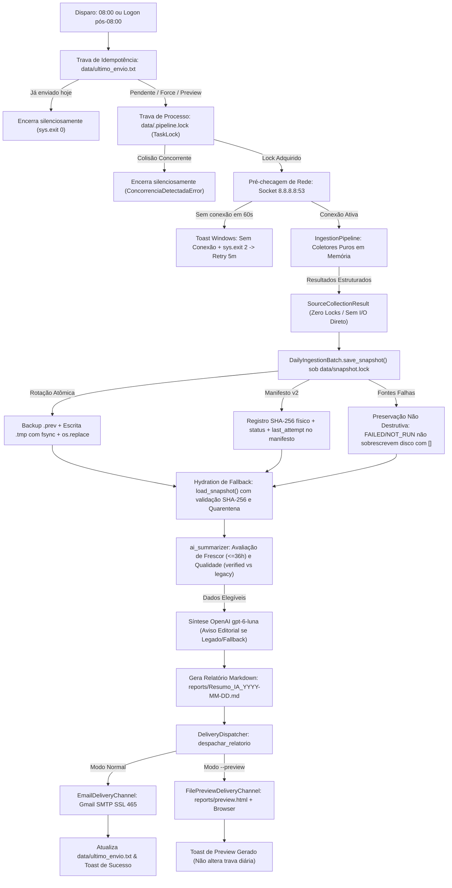

# Arquitetura do Sistema: Diário de Engenharia

Este documento descreve a arquitetura técnica, fluxo de dados, modelos de execução e componentes do **Diário de Engenharia (IA & Coding Agents)**.

---

## 1. Visão Geral e Fluxo do Pipeline

O sistema opera como um pipeline orquestrado sequencial de 5 etapas com isolamento de falhas, desacoplamento estrito de I/O e garantia de idempotência diária:



---

## 2. Mapa de Componentes e Responsabilidades

A estrutura do projeto adota responsabilidade única estrita em cada módulo:

| Módulo / Arquivo | Responsabilidade | Seam / Interface |
| :--- | :--- | :--- |
| **`main.py`** | Ponto de entrada CLI unificado, validação de argumentos, guarda de rede, controle de concorrência e orquestração do pipeline. | `--force`, `--step`, `--status`, `--status-banners`, `--check-auth`, `--to`, `--preview` |
| **`src/core/config.py`** | Carregamento de variáveis de ambiente (`.env`), resolução de caminhos absolutos e credenciais. | Classe `Config` e constantes de diretórios |
| **`src/core/logger.py`** | Logger centralizado com saída em console e arquivo rotativo (`logs/execucao.log`, 5MB, até 3 backups). | `get_logger(name)` |
| **`src/core/models.py`** | Modelos fortemente tipados e imutáveis (`frozen=True`: `Tweet`, `GitHubRepo`, `ResearchPaper`, `DailyIngestionBatch`, `SourceCollectionResult`, `SourceStatus`). Centraliza o protocolo transacional de persistência (`save_snapshot`) e recuperação (`load_snapshot`) com integridade SHA-256. | Dataclasses com `from_dict`, `to_dict`, `save_snapshot`, `load_snapshot` |
| **`src/core/manifest.py`** | Governança do manifesto v2 (`snapshot_metadata.json`), cálculo de hash SHA-256, migração em memória de v1 para v2 (`legacy_unverified`), validação de integridade/schema e avaliação de frescor temporal (`is_source_fresh`). | `validar_schema_manifesto`, `migrar_manifesto_v1_para_v2`, `is_source_fresh`, `_calcular_sha256_arquivo` |
| **`src/core/retry.py`** | Mecanismo de resiliência com backoff exponencial e jitter aleatório para chamadas de rede externas. | `retry_with_backoff(func, max_retries, initial_delay)` |
| **`src/core/notifier.py`** | Emissor de notificações nativas do Windows (Toast) via PowerShell para alertar início, conclusão e falhas. | `notificar_windows(titulo, mensagem)` |
| **`src/core/healthcheck.py`** | Diagnóstico rápido (< 5s) das credenciais e conectividade de todas as 5 integrações externas. | `executar_healthcheck()` |
| **`src/core/lock.py`** | Primitivas de exclusão mútua em nível de SO (`msvcrt` no Windows / `fcntl` no Linux) para lock de processo (`adquirir_trava_pipeline`) e de snapshot (`adquirir_trava_snapshot`), além de isolamento seguro de arquivos corrompidos (`mover_para_quarentena`). | `adquirir_trava_pipeline(path)`, `adquirir_trava_snapshot(path)`, `mover_para_quarentena(file, dir)` |
| **`src/core/smtp.py`** | Conexão de rede SMTP segura via TLS com validação ativa de certificados e hostname (`ssl.create_default_context()`). | `criar_conexao_smtp_ssl(host, port, timeout)` |
| **`src/collectors/base.py`** | Protocolo estrutural `IngestionSource` para coletores desacoplados de disco, exigindo retorno em memória de `SourceCollectionResult[T]` com tuplas imutáveis e estados formais. | `IngestionSource(name, target_field, collect())` |
| **`src/collectors/pipeline.py`** | Orquestrador de ingestão unificado com isolamento de falhas por fonte, execução com zero locks, persistência centralizada (`save_snapshot`) e hidratação de fallback (`load_snapshot`). | `IngestionPipeline(data_dir).run(target_source)` |
| **`src/collectors/twitter.py`** | Coletor puro do X/Twitter via Playwright (Chromium headless) com sessão persistente (`.session/`). Retorna `SourceCollectionResult[Tweet]` em memória sem escrita física em disco. | `TwitterSource`, `coletar_tweets_vip` |
| **`src/collectors/github.py`** | Coletor puro da API de busca do GitHub para elencar repositórios em alta. Retorna `SourceCollectionResult[GitHubRepo]` em memória sem escrita física em disco. | `GitHubSource`, `coletar_github_trending` |
| **`src/collectors/huggingface.py`**| Coletor puro da API do Hugging Face Daily Papers. Retorna `SourceCollectionResult[ResearchPaper]` em memória sem escrita física em disco. | `HuggingFaceSource`, `coletar_papers_huggingface` |
| **`src/processors/prompts.py`** | Banco de prompts isolados para curadoria, síntese analítica, tradução técnica e Takeaway de Engenharia. | `get_prompt_resumo_ia`, `get_prompt_github`, etc. |
| **`src/processors/ai_summarizer.py`**| Orquestrador de inferência com OpenAI (`gpt-6-luna`). Valida frescor (<= 36h) e qualidade dos dados, aplicando avisos editoriais para dados históricos/legados ou degradação graciosa para fontes ausentes. | `gerar_resumo_ia(batch=None, output_path=None, data_dir=None)` |
| **`src/delivery/banner_selector.py`** | Seletor rotativo de banners com hierarquia em 3 Tiers, catálogo de exaustão e feriados móveis/fixos. | `BannerSelector().selecionar_banner()` |
| **`src/delivery/renderer.py`** | Transforma o Markdown final em HTML responsivo estilo Bento Grid Modular com imagens servidas via GitHub Raw. | `render_bento_email(markdown_content)` |
| **`src/delivery/base.py`** | Protocolo `DeliveryChannel` e adaptadores de entrega (`EmailDeliveryChannel`, `FilePreviewDeliveryChannel`). | `DeliveryChannel.deliver(subject, html, recipient)` |
| **`src/delivery/dispatcher.py`**| Orquestrador de entrega que lê o Markdown, renderiza o HTML e despacha para o canal injetado. | `despachar_relatorio(caminho, channel, destinatario)` |
| **`src/delivery/sender.py`** | Facade retrocompatível para envio de e-mail via Gmail SMTP SSL. | `enviar_relatorio_email(destinatario, caminho_relatorio)` |

---

## 3. Padrões de Resiliência e Tolerância a Falhas

1. **Retries com Backoff Exponencial e Jitter:**
   Todas as chamadas externas propensas a instabilidade (GitHub Search API, Hugging Face API e OpenAI ChatCompletions) utilizam o decorador/executor `retry_with_backoff`. O intervalo de espera cresce exponencialmente com variação aleatória de jitter (`delay * (1 + random * 0.3)`), prevenindo thundering herds.

2. **Detecção de Rede Pré-Execução:**
   Ao ligar o computador, a placa de rede ou Wi-Fi pode levar de 5 a 25 segundos para negociar DHCP e rotas. O método `aguardar_conexao_internet` realiza um teste de socket direto na porta DNS (`8.8.8.8:53`) em vez de depender de requisições HTTP suscetíveis a redirecionamentos de captive portals ou bloqueios de firewall.

3. **Duplo Gatilho no Agendador do Windows (Task Scheduler):**
   Para garantir que o relatório sempre seja disparado sem intervenção manual:
   * **Gatilho de Calendário:** Dispara pontualmente às 08:00 AM se o computador já estiver ligado.
   * **Gatilho de Logon:** Dispara imediatamente quando o usuário loga ou desbloqueia a máquina após as 08:00 AM.
   * **Política de Reinicialização em Falha:** Se o script falhar por ausência de internet (exit code 2), o agendador retenta a cada 5 minutos por até 3 vezes.

4. **Execução Invisível (Zero Window Flash):**
   A chamada da automação pelo Windows ocorre através do wrapper `scripts/executar_silencioso.vbs`, que roda o processo Python com `WindowStyle = 0` (oculto). Isso previne que pop-ups de prompt de comando apareçam na tela do desenvolvedor e elimina o risco de travamento por cliques acidentais no modo QuickEdit do console do Windows.

---

## 4. Persistência e Estrutura de Diretórios

```text
├── assets/                          # Banners estáticos servidos via CDN pública GitHub Raw
├── data/                            # Dados, metadados, backups e travas de execução
│   ├── github_trending.json         # Dados ativos coletados do GitHub
│   ├── github_trending.json.prev    # Backup rotativo da última versão válida
│   ├── hf_papers.json               # Artigos científicos ativos em JSON
│   ├── hf_papers.json.prev          # Backup rotativo de papers científicos
│   ├── tweets_coletados.json        # Tweets e métricas ativas do X/Twitter
│   ├── tweets_coletados.json.prev   # Backup rotativo de tweets coletados
│   ├── snapshot_metadata.json       # Manifesto v2 com SHA-256, status e contagens
│   ├── snapshot_metadata.json.prev  # Backup rotativo do manifesto
│   ├── snapshot.lock                # Trava de SO para persistência e recuperação de snapshots
│   ├── .pipeline.lock               # Trava de SO para exclusão mútua do pipeline diário
│   ├── ultimo_envio.txt             # Trava diária de idempotência (YYYY-MM-DD)
│   └── quarantine/                  # Arquivos corrompidos isolados com timestamp e UUID4
├── logs/
│   └── execucao.log                 # Histórico unificado com rotação de até 15MB totais
├── reports/
│   └── Resumo_IA_YYYY-MM-DD.md      # Relatórios em Markdown versionados
├── scripts/                         # Scripts operacionais (execução silenciosa, setup e login)
├── src/                             # Código-fonte da aplicação
└── tests/                           # Suíte de testes automatizados com unittest
```

---

## 5. Decisões Arquiteturais Justificadas

1. **Localização dos Canais de Entrega (`src/delivery/base.py`):**
   A especificação inicial sugeria subdiretórios individuais (`src/delivery/channels/email.py` e `preview.py`). Ambos os canais somam menos de 90 linhas de código no total. Mantê-los coesos em `src/delivery/base.py` junto à definição do protocolo `DeliveryChannel` evita fragmentação desnecessária em micro-arquivos sem qualquer prejuízo ao encapsulamento ou à testabilidade.

2. **Persistência Atômica, Resiliência de Snapshots e Rastreabilidade (Spec 0007):**
   - **Desacoplamento de I/O nos Coletores (Resolução de ARC-01):** Os módulos coletores (`src/collectors/`) não realizam I/O físico em disco. Retornam instâncias imutáveis de `SourceCollectionResult[T]` com status explícito (`SUCCESS`, `EMPTY`, `PARTIAL`, `FAILED`, `NOT_RUN`). A responsabilidade de persistência física é centralizada exclusivamente em `DailyIngestionBatch.save_snapshot()`.
   - **Preservação Não Destrutiva de Snapshots Válidos (Resolução de DEF-01):** Coletas com falha (`FAILED`), parciais sem novos dados (`PARTIAL`) ou não executadas (`NOT_RUN`) jamais sobrescrevem os snapshots consolidados existentes em `data/` com listas vazias `[]`. O arquivo físico ativo e seus metadados anteriores permanecem preservados em disco.
   - **Protocolo de Escrita Transacional e Backup Rotativo (.prev):** Antes de qualquer gravação de novos dados, o arquivo ativo é rotacionado atomicamente para `.prev`. Os novos dados são gravados em arquivo temporário com PID/UUID (`.tmp`), sofrem `flush()` e `os.fsync()`, e são renomeados atomicamente via `os.replace()`, com fsync no diretório pai em ambientes POSIX.
   - **Governança do Manifesto v2 e Integridade SHA-256:** O arquivo `snapshot_metadata.json` adota schema versionado (`version: 2`) com rastreamento do ciclo de execução (`last_attempt`: status `running`/`completed`/`failed`, trigger e PID) e catálogo por fonte contendo o hash SHA-256 calculado a partir dos bytes em disco. O sintetizador e o loader rejeitam dirty reads se houver execução `running` ativa.
   - **Recuperação com Quarentena Delimitada:** Na leitura (`load_snapshot()`), se o arquivo ativo estiver ausente, corrompido ou com hash divergente do manifesto, ele é isolado em `data/quarantine/` (com nome composto por timestamp microssegundos e UUID4) e o arquivo `.prev` íntegro é promovido para ativo. A quarentena é estritamente delimitada aos artefatos de snapshot do pipeline, preservando outros arquivos em `data/`.
   - **Frescor Temporal e Migração Legada com Aviso Editorial:** O frescor é avaliado no intervalo $[-300\text{s}, 36\text{h}]$ via `is_source_fresh()`. Snapshots históricos pré-Spec 0007 são migrados em memória com flag `quality: "legacy_unverified"`. Quando o sintetizador consome dados legados ou de contingência histórica após falha no dia atual, injeta automaticamente uma nota editorial de advertência no início da seção correspondente.

3. **MIME Multipart com Fallback em Texto Puro (`plain_text`):**
   O parâmetro opcional `plain_text` no método `deliver` de `DeliveryChannel` permite anexar uma versão em texto puro como parte alternativa (`multipart/alternative`), prevenindo alertas de spam e renderização de anexos binários em clientes de e-mail corporativos.


---

## 6. Fronteiras de Confiança e Modelo de Blindagem

### Mapeamento de Zonas de Confiança
| Zona | Componentes | Nível de Confiança | Mecanismos de Blindagem |
| :--- | :--- | :--- | :--- |
| **Z1: Fontes Externas** | APIs públicas, Feeds, X/Twitter, ArXiv, GitHub | **Não Confiável** | Timeout estrito, cabeçalhos de User-Agent, parsing resiliente. |
| **Z2: Síntese de Conteúdo** | LLM configurada (processamento de texto e geração) | **Não Determinística** | Prompts estruturados; o Markdown gerado é considerado **não confiável** para inserção em HTML. |
| **Z3: Renderização Determinística** | `src/delivery/renderer.py` | **Fronteira de Blindagem** | `format_inline()`, `html.escape(..., quote=True)`, validação de RFC/Userinfo em `_is_safe_url()`, teste canônico de invariantes. |
| **Z4: Canais de Entrega e Apresentação** | `src/delivery/base.py`, SMTP Gmail, Preview no Navegador | **Transporte & Exibição** | Conexão SMTP com TLS estrito (`ssl.create_default_context()`) para entrega de e-mail; gravação local em arquivo para preview (o navegador pode realizar requisições de rede para carregar recursos remotos referenciados no HTML, como imagens externas). A segurança do conteúdo continua sob responsabilidade do renderizador. |

### A. As 4 Ressalvas Conceituais da Retrospectiva
1. **Fronteiras Independentes e Conteúdo Não Confiável por Definição:** Mapeamento explícito e separado das fronteiras entre fontes externas, síntese pela LLM configurada, Markdown gerado, renderer determinístico e canais de entrega. Todo conteúdo externo e todo Markdown da LLM devem ser tratados como não confiáveis até passarem pelo tratamento contextual do renderizador.
2. **Blindagem Determinística no Renderer:** A proteção contra XSS e HTML Injection depende exclusivamente da implementação determinística do renderizador (escape contextual, validação de URLs e cobertura exaustiva de campos dinâmicos).
3. **Desvinculação entre Sanitização HTML e Prompt Injection:** A sanitização e neutralização de tags HTML no renderizador **não resolve nem mitiga Prompt Injection**; Prompt Injection é um vetor de manipulação semântica da LLM pertencente à fronteira da IA, demandando defesas próprias de prompt e curadoria.
4. **Separação Rigorosa entre Segurança de Transporte e de Conteúdo:** O transporte via SMTP com TLS protege a confidencialidade e integridade do canal de conexão, mas não garante que o conteúdo, as afirmações editoriais ou os links incluídos sejam idôneos ou seguros.

### B. Os 3 Princípios Complementares Derivados
5. **Risco Residual de Phishing em URLs Sintaticamente Válidas:** A validação sintática estrita de URLs (`_is_safe_url()`) garante conformidade com RFC 1123, hostname válido e ausência de userinfo, mas não verifica a reputação do domínio de destino; URLs sintaticamente perfeitas ainda podem direcionar para destinos maliciosos.
6. **Segurança Relativa do HTML Gerado:** O documento HTML final não é rotulado como "universalmente seguro"; sua segurança é relativa e estritamente delimitada pelas regras de sanitização implementadas e cobertas pela suíte canônica de testes de invariantes.
7. **Preview Local no Navegador como Superfície Ativa:** A prévia local (`--preview`) não realiza envio SMTP (grava o relatório em `reports/preview.html` e aciona o navegador padrão). Contudo, o navegador pode realizar requisições de rede para carregar recursos remotos (como imagens e fontes externas) e interpreta ativamente o HTML renderizado. Portanto, o preview local exige as mesmas garantias de blindagem contra injeção e execução de scripts que o relatório transmitido por e-mail, sendo a segurança do conteúdo de inteira responsabilidade do renderizador determinístico. Não se deve assumir que o preview bloqueia tráfego externo.
