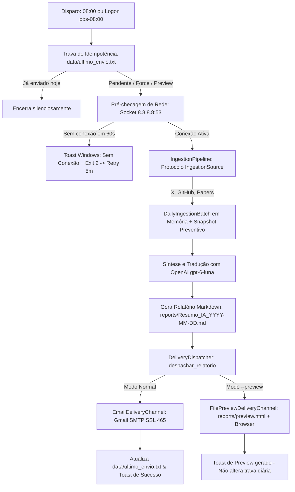

# Arquitetura do Sistema: Diário de Engenharia

Este documento descreve a arquitetura técnica, fluxo de dados, modelos de execução e componentes do **Diário de Engenharia (IA & Coding Agents)**.

---

## 1. Visão Geral e Fluxo do Pipeline

O sistema opera como um pipeline orquestrado sequencial de 5 etapas com isolamento de falhas e garantia de idempotência diária:



---

## 2. Mapa de Componentes e Responsabilidades

A estrutura do projeto adota responsabilidade única estrita em cada módulo:

| Módulo / Arquivo | Responsabilidade | Seam / Interface |
| :--- | :--- | :--- |
| **`main.py`** | Ponto de entrada CLI unificado, validação de argumentos, guarda de rede e orquestração do pipeline. | `--force`, `--step`, `--status`, `--check-auth`, `--to`, `--preview` |
| **`src/core/config.py`** | Carregamento de variáveis de ambiente (`.env`), resolução de caminhos absolutos e credenciais. | Classe `Config` e constantes de diretórios |
| **`src/core/logger.py`** | Logger centralizado com saída em console e arquivo rotativo (`logs/execucao.log`, 5MB, até 3 backups). | `get_logger(name)` |
| **`src/core/models.py`** | Modelos fortemente tipados (`Tweet`, `GitHubRepo`, `ResearchPaper`, `DailyIngestionBatch`) com sanitização e snapshot. | Dataclasses com `from_dict`, `to_dict`, `save_snapshot`, `load_snapshot` |
| **`src/core/retry.py`** | Mecanismo de resiliência com backoff exponencial e jitter aleatório para chamadas de rede externas. | `retry_with_backoff(func, max_retries, initial_delay)` |
| **`src/core/notifier.py`** | Emissor de notificações nativas do Windows (Toast) via PowerShell para alertar início, conclusão e falhas. | `notificar_windows(titulo, mensagem)` |
| **`src/core/healthcheck.py`** | Diagnóstico rápido (< 5s) das credenciais e conectividade de todas as 5 integrações externas. | `executar_healthcheck()` |
| **`src/collectors/base.py`** | Protocolo estrutural `IngestionSource` para desacoplamento de fontes de dados. | `IngestionSource(name, target_field, collect())` |
| **`src/collectors/pipeline.py`** | Orquestrador de ingestão unificado com isolamento de falhas por fonte e persistência de snapshot. | `IngestionPipeline().run(target_source)` |
| **`src/collectors/twitter.py`** | Automação com Playwright (Chromium headless) com sessão persistente (`.session/`) para raspar Feed e Radar VIP. | `TwitterSource`, `coletar_tweets_vip` |
| **`src/collectors/github.py`** | Cliente HTTP nativo que consome a API de busca do GitHub para elencar os repositórios mais favoritados da semana. | `GitHubSource`, `coletar_github_trending` |
| **`src/collectors/huggingface.py`**| Cliente HTTP nativo que busca e elenca os artigos científicos mais votados do Hugging Face Daily Papers. | `HuggingFaceSource`, `coletar_papers_huggingface` |
| **`src/processors/prompts.py`** | Banco de prompts isolados para curadoria, síntese analítica, tradução técnica e Takeaway de Engenharia. | `get_prompt_resumo_ia`, `get_prompt_github`, etc. |
| **`src/processors/ai_summarizer.py`**| Orquestrador de inferência com OpenAI (`gpt-6-luna`), consumindo `DailyIngestionBatch` em memória. | `gerar_resumo_ia(batch=None)` |
| **`src/delivery/renderer.py`** | Transforma o Markdown final em HTML responsivo estilo Bento Grid Modular com imagens servidas via GitHub Raw. | `render_bento_email(markdown_content)` |
| **`src/delivery/base.py`** | Protocolo `DeliveryChannel` e adaptadores de entrega (`EmailDeliveryChannel`, `FilePreviewDeliveryChannel`). | `DeliveryChannel.deliver(subject, html, recipient)` |
| **`src/delivery/dispatcher.py`**| Orquestrador de entrega que lê o Markdown, renderiza o HTML e despacha para o canal injetado. | `despachar_relatorio(caminho, channel, destinatario)` |
| **`src/delivery/sender.py`** | Facade retrocompatível para envio de e-mail via Gmail SMTP SSL. | `enviar_relatorio_email(destinatario, caminho_relatorio)` |

---

## 3. Padrões de Resiliência e Tolerância a Falhas

1. **Retries com Backoff Exponencial e Jitter:**
   Todas as chamadas externas propensas a instabilidade (GitHub Search API, Hugging Face API e OpenAI ChatCompletions) utilizam o decorador/executor `retry_with_backoff`. O intervalo de espera cresce exponencialmente com variação aleatória de jitter (`delay * (1 + random * 0.3)`), prevenindo thundering herds.

2. **Detecção de Rede Pré-Execução:**
   Ao ligar o computador, a placa de rede ou Wi-Fi pode levar de 5 a 25 segundos para negociar DHCP e rotas. O método `aguardar_conexao_internet` realiza um teste de socket direto na porta DNS (`8.8.8.8:53`) em vez de depender de requisições HTTP suscetíveis a redirecionamentos de captive portals ou bloqueios de firewall.

3. **Duplo Gatilho no Agendador do Windows (Task Scheduler):**
   Para garantir que o relatório sempre seja disparado sem intervenção manual:
   * **Gatilho de Calendário:** Dispara pontualmente às 08:00 AM se o computador já estiver ligado.
   * **Gatilho de Logon:** Dispara imediatamente quando o usuário loga ou desbloqueia a máquina após as 08:00 AM.
   * **Política de Reinicialização em Falha:** Se o script falhar por ausência de internet (exit code 2), o agendador retenta a cada 5 minutos por até 3 vezes.

4. **Execução Invisível (Zero Window Flash):**
   A chamada da automação pelo Windows ocorre através do wrapper `scripts/executar_silencioso.vbs`, que roda o processo Python com `WindowStyle = 0` (oculto). Isso previne que pop-ups de prompt de comando apareçam na tela do desenvolvedor e elimina o risco de travamento por cliques acidentais no modo QuickEdit do console do Windows.

---

## 4. Persistência e Estrutura de Diretórios

```text
├── assets/                     # Banners estáticos servidos via CDN pública GitHub Raw
├── data/                       # Arquivos temporários e estado de execução
│   ├── github_trending.json    # Dados brutos coletados do GitHub
│   ├── hf_papers.json          # Artigos científicos em JSON
│   ├── tweets_coletados.json   # Tweets e metadados de engajamento do X
│   └── ultimo_envio.txt        # Trava diária contendo a data do último envio (YYYY-MM-DD)
├── logs/
│   └── execucao.log            # Histórico unificado com rotação de até 15MB totais
├── reports/
│   └── Resumo_IA_YYYY-MM-DD.md # Relatórios em Markdown versionados
├── scripts/                    # Scripts operacionais (execução silenciosa, setup e login)
├── src/                        # Código-fonte da aplicação
└── tests/                      # Suíte de testes automatizados com unittest
```

---

## 5. Decisões Arquiteturais Justificadas

1. **Localização dos Canais de Entrega (`src/delivery/base.py`):**
   A especificação inicial sugeria subdiretórios individuais (`src/delivery/channels/email.py` e `preview.py`). Ambos os canais somam menos de 90 linhas de código no total. Mantê-los coesos em `src/delivery/base.py` junto à definição do protocolo `DeliveryChannel` evita fragmentação desnecessária em micro-arquivos sem qualquer prejuízo ao encapsulamento ou à testabilidade.

2. **Isolamento de Snapshots e Rastreabilidade Temporal:**
   Execuções completas (`all`) geram um lote unificado e persistem preventivamente os 3 snapshots em disco com estampa consolidada em `snapshot_metadata.json`. Em passos de coleta isolada (`--step collect-<fonte>`), apenas o arquivo e o metadado da fonte alvo são atualizados em disco, garantindo que coletas antigas de outras fontes não recebam uma falsa estampa de coleta recente. Na etapa isolada de síntese (`--step summarize`), `DailyIngestionBatch.load_snapshot()` reconstitui o estado existente em `data/` como mecanismo de fallback/recuperação.

3. **MIME Multipart com Fallback em Texto Puro (`plain_text`):**
   O parâmetro opcional `plain_text` no método `deliver` de `DeliveryChannel` permite anexar uma versão em texto puro como parte alternativa (`multipart/alternative`), prevenindo alertas de spam e renderização de anexos binários em clientes de e-mail corporativos.

