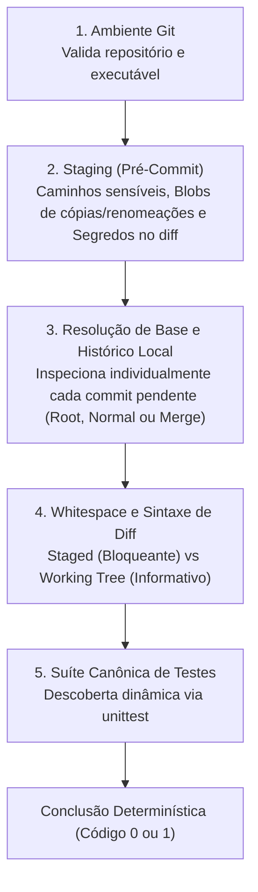

# Guia Operacional: Preflight Canônico (`scripts/preflight.py`)

Este guia orienta desenvolvedores e agentes de IA sobre a utilização, o contrato funcional e o diagnóstico de falhas do **Preflight Canônico** do repositório `Relatorios-IA`.

---

## 1. Visão Geral e Filosofia

O script [`scripts/preflight.py`](../../scripts/preflight.py) é o portão de qualidade mandatório da *Definition of Done* antes de propor commits locais ou publicações remotas (*push*).

### Princípios de Engenharia:
* **Estritamente Read-Only:** Não executa mutações no Git (`git add`, `git reset`, `git commit`) e não altera configurações ou arquivos.
* **Isolamento de Rede:** Opera de forma 100% hermética e local. **Não executa `git fetch` automaticamente**.
* **Zero Dependências:** Construído unicamente sobre a biblioteca padrão do Python (`sys`, `os`, `subprocess`, `pathlib`, `re`).
* **Higiene de Ambiente:** Utiliza `--no-ext-diff` e `--no-textconv` em invocações do Git e define `PYTHONDONTWRITEBYTECODE=1` para evitar poluição de cache `__pycache__`.

---

## 2. Invocação Canônica

A partir da raiz do repositório:

```bash
python scripts/preflight.py
```

O script utiliza internamente `sys.executable` para invocar a suíte de testes com o mesmo interpretador Python ativo no terminal.

---

## 3. O que é Verificado

O preflight executa um pipeline sequencial com interrupção imediata em falhas críticas (*fail-fast*):



### Detalhamento das Etapas:

1. **Inspeção de Staging (Pré-Commit):**
   - Utiliza `git diff --cached --name-status -C --find-copies-harder --no-ext-diff -z`.
   - Bloqueia adições (`A`), modificações (`M`), trocas de tipo (`T`), renomeações (`R`) e cópias (`C`) envolvendo arquivos proibidos.
   - Para cópias (`C`), lê o conteúdo integral do blob de destino (`git show --no-ext-diff --no-textconv :<path>`) para detectar segredos copiados para nomes inofensivos.
   - Permite deleções isoladas (`D`) como saneamento seguro.
2. **Inspeção de Commits Locais (Pré-Push):**
   - Determina a lista de commits pendentes de envio em relação à base remota.
   - Inspeciona cada commit atomicamente:
     - *Root Commits:* `git diff-tree --no-commit-id --root ...`
     - *Commits Normais:* `git diff-tree --no-commit-id <sha>~1 <sha>`
     - *Commits de Merge:* `git diff-tree --no-commit-id <sha>^1 <sha>`
   - Garante que segredos adicionados em um commit e removidos em outro sejam flagrados no commit de origem.
3. **Detecção de Segredos por Regex Estrito:**
   - Detecta chaves privadas PEM, tokens GitHub (`ghp_`, `github_pat_`), chaves de API Google (`AIza`) e senhas de app Gmail.
   - **Masking Obrigatório:** Nunca imprime valores reais de tokens no terminal ou logs (`ghp_****...****`).
4. **Validação de Whitespace:**
   - `git diff --cached --check`: Erros de whitespace ou marcadores de conflito (`<<<<<<<`) no staging **bloqueiam** a execução.
   - `git diff --check`: Erros na working tree não-staged emitem **aviso amarelo informativo**, sem bloquear.
5. **Execução Dinâmica de Testes:**
   - Executa `python -m unittest discover -s tests -t . -v`.
   - Valida `returncode == 0` e confirma dinamicamente que a contagem de testes foi maior que zero (`Ran N tests`).
   - Se zero testes forem descobertos, encerra com erro.

---

## 4. Códigos de Saída, Prontidão para Publicação e Semântica Git

| Código | Significado | Prontidão para Push | Próxima Ação |
| :---: | :--- | :---: | :--- |
| **`0`** | **Verificações Locais Aprovadas.** Staging e commits locais seguros; suíte de testes 100% verde. | Condicional ao estado Git | Consultar o estado da branch antes de publicar. |
| **`1`** | **Falha de Validação.** Segredos detectados, conflito não resolvido, whitespace corrompido no index ou testes quebrados. | **NÃO** | Corrigir as violações apontadas e reexecutar o preflight. |

### Diferenciação entre Aprovação Local e Prontidão para Publicação:

* **Aprovação Local (Código 0):** Certifica estritamente que o staging, os commits locais pendentes e a suíte de testes estão seguros e sem violações.
* **Prontidão para Publicação (`pronto_para_push = True`):** Exclusiva do estado `AHEAD`. Indica que há commits locais validados e a branch está em condições de envio imediato via `git push`.
* **Necessidade de Reconciliação com o Remoto:** Nos estados `BEHIND` e `DIVERGED`, as verificações locais são aprovadas (código 0), mas a publicação **não é autorizada** até que o desenvolvedor execute a sincronização remota.

### Estados de Relacionamento Git:

* **`SYNCED`:** A branch local possui o mesmo commit do remoto (`HEAD == origin/main`). 0 commits a enviar (`pronto_para_push = False`).
* **`AHEAD`:** A branch local possui commits exclusivos à frente do remoto prontos para publicação via `git push` (`pronto_para_push = True`).
* **`BEHIND`:** O remoto avançou. As validações locais passaram, mas é obrigatório executar `git pull` antes de publicar (`pronto_para_push = False`).
* **`DIVERGED`:** Houve divergência entre local e remoto. Os commits locais foram validados, mas exigem reconciliação (`git merge` ou `git rebase`) antes do push (`pronto_para_push = False`).
* **`AHEAD_LOCAL`:** Commits validados contra uma branch local (ex: `main`), sem remoto configurado. Não confere prontidão de push (`pronto_para_push = False`).
* **`UNRELATED` / `UNKNOWN`:** Árvores sem ancestral comum ou sem base confiável. O preflight **rejeita com código 1**.

---

## 5. Regras de Segurança e Fixtures de Teste

### Arquivos Proibidos por Caminho:
* `.env`, `.env.*`, `.env_*`, `.env-*` (exceção explícita autorizada: `.env.example` em qualquer nível de pasta).
* `auth.json`, `email_config.json`.
* `.session/` (todo o diretório).
* `*.pem`, `*.key`, `*.pfx`, `*.pkcs12`.
* `data/ultimo_envio.txt`, `data/*.lock`, `data/*.tmp`, `data/quarantine/*`, `*.lock`.

### Política de Fixtures em Testes Automatizados:
Para evitar falsos positivos nos testes, fixtures e mocks **devem utilizar placeholders sintaticamente inválidos** que nunca coincidem com as especificações oficiais:
* Em vez de um token fictício com 36 caracteres alfanuméricos, use: `"ghp_TEST_PLACEHOLDER"` (tamanho inválido).
* Em vez de uma chave Google com 39 caracteres, use: `"AIza_MOCK_INVALID_KEY"` (tamanho inválido).
* Em vez de chave PEM real, use: `"-----BEGIN DUMMY TEST KEY-----"`.

---

## 6. Troubleshooting de Falhas Comuns

### "Arquivo proibido detectado no commit local X"
* **Causa:** Um arquivo sensível (como `.env` ou `auth.json`) foi incluído em um commit local pendente, mesmo que já tenha sido deletado em commit posterior.
* **Solução:** Remova o arquivo do histórico local utilizando `git rebase -i` ou `git reset` para desfazê-lo antes de tentar publicar.

### "Conflito de merge não resolvido (status 'U')"
* **Causa:** Há marcadores de conflito ou arquivos em estado unmerged no staging.
* **Solução:** Resolva os conflitos no arquivo, adicione com `git add <arquivo>` e complete o merge antes do preflight.

### "Base de publicação indeterminada"
* **Causa:** A branch atual não possui upstream configurado e não foi encontrada a referência `origin/main`.
* **Solução:** Configure o upstream da branch (`git branch --set-upstream-to=origin/<branch>`) ou atualize as referências locais via `git fetch origin`.
